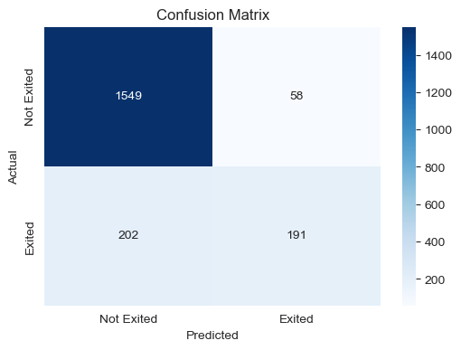
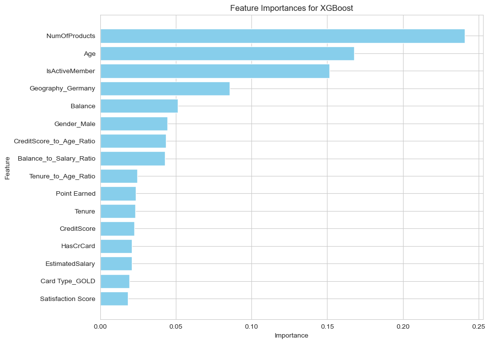

# Banking Customer Churn Prediction & Retention Analysis

**Python · Machine Learning · Predictive Analytics | MSc Business Analytics Dissertation (2025)**

## Overview

This project investigates how machine learning can help identify bank customers at risk of churn and inform more targeted retention efforts. It uses a public, historical customer dataset and compares classification models alongside the customer characteristics most useful for prediction.

The project originated from my MSc Business Analytics dissertation. This repository presents the main analytical workflow and results in a concise portfolio format; it does not claim that the models or retention recommendations were deployed by a bank.

## Business Questions

1. How accurately can customer churn be predicted from demographic, financial and engagement-related data?
2. Which models provide the most useful trade-off between identifying churners and avoiding false alerts?
3. Which customer characteristics are most informative for churn prediction?
4. How could these findings guide further investigation and targeted retention initiatives?

## Dataset

- **Source:** [Bank Customer Churn — Kaggle](https://www.kaggle.com/datasets/radheshyamkollipara/bank-customer-churn)
- **Size:** 10,000 customer records, 18 original columns; 2,038 churned customers (20.38%)
- **Target:** `Exited` (1 = churned, 0 = retained)
- **Quality checks:** No missing values or fully duplicated rows in the supplied CSV

The original `Complain` feature is almost perfectly associated with the target in this dataset. It was **excluded from the modelling features** to prevent it from dominating churn prediction and obscuring other useful predictors. The repository links to the public dataset instead of redistributing the CSV.

## Analytical Approach

1. **Prepare the data:** Explore the data, drop identifiers and `Complain`, encode categorical variables, and create balance-to-salary, tenure-to-age and credit-score-to-age ratios.
2. **Feature selection & scaling:** Split the data into training (80%) and test (20%) sets. Used Mutual Information on the training data to select relevant predictors, and applied StandardScaler for scale-sensitive models while retaining unscaled features for tree-based models.
3. **Class imbalance handling:** With churned customers representing 20.38% of the dataset, compared Random Oversampling, Random Undersampling and SMOTE on the training data to examine their effects on classification performance and precision–recall trade-offs.
4. **Train and compare classifiers:** Evaluate Decision Tree, Random Forest, XGBoost, Logistic Regression and Neural Network models, including hyperparameter tuning using GridSearchCV.
5. **Interpret results:** Compare classification metrics, confusion matrices and feature importance to discuss implications for customer retention.

See the [analysis notebook](notebooks/bank_customer_churn_analysis.ipynb) for the code, saved outputs and visualisations.

## Selected Model Results

Five machine learning algorithms were evaluated. The table below highlights selected tuned configurations that illustrate the main precision–recall trade-offs. Full model comparisons and evaluation outputs are available in the [Jupyter Notebook](notebooks/bank_customer_churn_analysis.ipynb).

| Model / configuration | ROC-AUC | Precision | Recall |
|---|---:|---:|---:|
| XGBoost (tuned) | **0.87** | **0.77** | 0.49 |
| Random Forest (tuned, oversampling) | 0.86 | 0.68 | 0.55 |
| Random Forest (tuned, undersampling) | 0.86 | 0.48 | **0.74** |

*Results are from the saved notebook/dissertation outputs, rounded to two decimal places; they have not been independently rerun in this portfolio preparation.*

XGBoost achieved the highest ROC-AUC and precision among the compared tuned models. But model selection depends on the bank's priorities: higher precision can limit unnecessary retention outreach, whereas higher recall can reduce missed churners. The Random Forest undersampling configuration illustrates this trade-off.



## Business Findings & Implications

- **Engagement and product usage matter:** `NumOfProducts`, `Age` and `IsActiveMember` were prominent predictors in the tree-based feature-importance analyses. Their relative importance differs by model; importance is not evidence of causation.
- **Prediction involves operational trade-offs:** The tuned XGBoost confusion matrix correctly identified **191** churned customers but missed **202**; it also generated **58** false positives on the reported test set. This makes outreach capacity and the cost of missed customers relevant to model choice.
- **Potential application:** Use predicted risk *alongside* existing customer context to prioritise outreach, investigate inactive customer segments, and evaluate tailored product/service offers through controlled pilots. Business impact would need to be measured after implementation.



## Reproducing the Notebook

1. Download `Customer-Churn-Records.csv` from the [dataset source](https://www.kaggle.com/datasets/radheshyamkollipara/bank-customer-churn).
2. Place the CSV in the **`notebooks/` folder**, next to `bank_customer_churn_analysis.ipynb` (the original code reads it using a relative file path).
3. Create a Python environment and install the packages in `requirements.txt`.
4. Open the notebook in Jupyter and run the cells in order. Full hyperparameter searches can be computationally expensive and results may vary with package versions.

```bash
pip install -r requirements.txt
jupyter notebook
```

## Scope & Limitations

- This is a historical, public teaching/research dataset rather than a production banking dataset; generalisation to another institution has not been demonstrated.
- Class imbalance affects the usefulness of Accuracy alone, so the project also evaluates Precision, Recall, F1-score, ROC-AUC and confusion matrices.
- Some original hyperparameter searches used resampled training data **before** cross-validation, which can make CV-based model selection optimistic. The reported holdout scores should be treated as *illustrative*, not independently verified deployment-ready estimates.
- Saved notebook outputs preserve the original dissertation experiments. The unsupported RandomizedSearchCV trial at the end of the original notebook has been excluded from this portfolio copy; core model code and results have not been rewritten.
- Features predictive of churn do not establish why customers leave, and the proposed retention actions have not been experimentally evaluated.

## Repository Contents

```text
bank-customer-churn-prediction/
├── README.md
├── notebooks/
│   └── bank_customer_churn_analysis.ipynb
├── images/
│   ├── baseline_model_comparison.png
│   ├── xgboost_confusion_matrix.png
│   └── xgboost_feature_importance.png
├── requirements.txt
└── .gitignore
```
